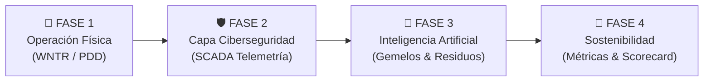

# 🌊 TRITON Smart Water Digital Twin — Resumen Ejecutivo y Operativo

Este documento sintetiza la **arquitectura, funcionamiento, fundamentos matemáticos y estrategia operativa** implementada en la aplicación del **Framework TRITON** (*Technology Resilience, cybersecurity and Intelligence for Transformative Optimization of smart water Networks*).

---

## 🎯 1. Propósito y Filosofía del Sistema

Las redes de distribución de agua potable (WDN) son infraestructuras críticas que enfrentan simultáneamente dos amenazas:
1. **Fallas Físicas Catastróficas:** Fugas no visibles, roturas por sobrepresión, apagones en estaciones de bombeo y tomas clandestinas de agua no registrada (NRW).
2. **Ciberamenazas SCADA/IoT:** Manipulación maliciosa de lecturas de sensores (*False Data Injection* / Spoofing) para engañar al operador y provocar maniobras destructivas (golpes de ariete o apagado indebido de bombas).

El simulador **TRITON** soluciona esto mediante un **Gemelo Digital Ciberfísico Asistido por IA** que desacopla la física real de las tuberías de la telemetría reportada, permitiendo detectar incidentes en **menos de 1 hora** en lugar de los 2 a 3 días que toma un sistema SCADA reactivo convencional.

---

## 🏗️ 2. Arquitectura de las 4 Fases de TRITON

La estrategia del framework se estructura en **4 fases secuenciales interconectadas**:



### 🌊 Fase 1: Operación Física (Physical Twin)
* **Motor Hidráulico:** Basado en **WNTR 1.5.0** acoplado al solver hidráulico PDD (*Pressure-Driven Demand*).
* **Física Realista de Fugas:** En lugar de asumir demandas fijas, el escape de agua se rige por la ley de orificios de **Torricelli**:
  $$Q_{leak}(t) = C_d \cdot A \cdot \sqrt{2 \cdot g \cdot P(t)}$$
* **Balance Energético de Estaciones de Bombeo:** Calcula el consumo eléctrico real en kilovatios-hora ($kWh$):
  $$E_{pump} = \sum_{t} \frac{\rho \cdot g \cdot Q_{pump}(t) \cdot \Delta H_{pump}(t)}{\eta_{pump} \cdot 3.6 \times 10^6} \cdot \Delta t$$
  *(donde $\rho = 1000\text{ kg/m}^3$, $g = 9.80665\text{ m/s}^2$ y $\eta$ es la eficiencia electromecánica).*

---

### 🛡️ Fase 2: Capa de Ciberseguridad (Cyber Twin)
* **Desacoplamiento Estricto:** Mantiene separados dos estados de la red:
  * $P_{phys}$: La presión hidráulica real calculada por las ecuaciones de Navier-Stokes y conservación de masa.
  * $P_{obs}$: La presión reportada por los sensores IoT al sistema SCADA.
* **Vector de Ataque FDI (*False Data Injection*):** Un ciberatacante altera los datos del sensor en tránsito:
  $$P_{obs}(t) = P_{phys}(t) + \Delta P_{bias}$$
  *(Permitiendo evaluar si el operador o los algoritmos son engañados por la telemetría).*

---

### 🧠 Fase 3: Capa de Inteligencia Artificial y Comparador de Gemelos
Combina dos mecanismos de inferencia:

1. **Extracción de Residuos Multivariados:**
   * **Residuo Ciber / Integridad Sensorial ($R_{sens}$):**
     $$R_{sens}(t) = \max_n \left| P_{obs, n}(t) - P_{phys, n}(t) \right|$$
     *Si $R_{sens} > \text{Umbral}_{ciber}$ ($1.0\text{ mca}$), existe un ciberataque de manipulación de datos.*
   * **Residuo Físico Dinámico / Contrafactual ($R_{dyn}$):**
     $$R_{dyn}(t) = \max_n \left| P_{phys, n}(t) - P_{base, n}(t) \right|$$
     *Si $R_{dyn} > \text{Umbral}_{físico}$ ($0.08\text{ mca}$), el comportamiento físico de las tuberías ha cambiado respecto a la operación normal.*

2. **Modelo de Machine Learning (Isolation Forest):**
   * Entrenado sobre la matriz temporal-espacial de operación base para detectar anomalías no lineales complejas.

3. **Árbol de Decisión Diagnóstico:**
   ```mermaid
   flowchart TD
       Start["Lectura de Residuos"] --> Q1{"¿$R_{sens} > 1.0\\text{ m}$?<br>(Discrepancia Sensores vs Física)"}
       Q1 -- Sí --> Q2{"¿$R_{dyn} > 0.08\\text{ m}$?<br>(Física perturbada)"}
       Q2 -- Sí --> H["🎭 Ataque Híbrido Sigiloso<br>(Fuga real + Spoofing para encubrirla)"]
       Q2 -- No --> C["🕵️ Ciberataque FDI / Spoofing<br>(Física normal, sensor falsificado)"]
       Q1 -- No --> Q3{"¿$R_{dyn} > 0.08\\text{ m}$ o Isolation Forest?<br>(Física perturbada)"}
       Q3 -- Sí --> P["💧 Falla Física Real<br>(Fuga, Cierre, Falla de Bomba o Toma Ilícita)"]
       Q3 -- No --> N["🟢 Operación Normal"]
   ```

---

### 🌱 Fase 4: Métricas de Sostenibilidad y Scorecard TRITON
Consolida el impacto en agua, energía y servicio en una tarjeta de control estandarizada (*Scorecard*) estructurada en **3 ejes normativos**:

| Código | Eje | Indicador de Dominio | Meta / Condición Óptima |
| :--- | :--- | :--- | :--- |
| **CI-01** | Ciberseguridad | Protección e Integridad de Datos | Desviación máxima $< 0.5\text{ m}$ |
| **CI-02** | Ciberseguridad | Control de Acceso y Defensa ante Spoofing | Precisión y Recall en detección $\ge 90\%$ |
| **CI-10** | Ciberseguridad | Monitoreo de Telemetría en Tiempo Real | Ciclo continuo SCADA/IoT Activo |
| **SO-01** | Sostenibilidad | Uso Eficiente del Agua (Pérdidas NRW) | Pérdida de agua $< 1.0\text{ m}^3$ |
| **SO-03** | Sostenibilidad | Eficiencia Energética de Bombeo | Consumo específico $kWh/m^3$ optimizado |
| **SO-06** | Sostenibilidad | Continuidad del Suministro ($P \ge 20\text{ mca}$) | Disponibilidad $\ge 95\%$ |
| **IA-03** | Inteligencia Artificial | Detección de Anomalías (Isolation Forest) | $F_1\text{-score} \ge 0.80$ |
| **IA-05** | Inteligencia Artificial | Analítica Hidráulica en Tiempo Real | Umbrales dinámicos adaptados a la topología |

---

## 🧪 3. Banco de los 7 Escenarios Disponibles

La aplicación cuenta con 7 presets de ejecución inmediata:

| N° | Escenario | Vector de Alteración | Diagnóstico TRITON |
| :---: | :--- | :--- | :--- |
| **1** | **Operación Normal** | Estado nominal sin perturbaciones | 🟢 Normal (0 falsas alarmas) |
| **2** | **Fuga Física** | Orificio de fuga calibrado (ej. $16\text{ mm}$ en nodo 113) | 💧 Falla Física (Fuga) |
| **3** | **Spoofing FDI** | Sesgo artificial en sensor (ej. $+18\text{ m}$ en nodo 111) | 🕵️ Ciberataque FDI |
| **4** | **Cierre de Tubería** | Bloqueo o sabotaje de válvula en tubería troncal | 🚫 Falla Física (Bloqueo) |
| **5** | **Falla de Bomba** | Apagón eléctrico o parada forzada de estación de bombeo | ⚡ Falla Física (Parada) |
| **6** | **Consumo Ilícito** | Toma clandestina de alto caudal ($20\text{ L/s}$ en nodo 113) | 🏭 Falla Física (Consumo Anómalo) |
| **7** | **Híbrido Sigiloso** | Fuga real concurrente con sensor spoofing que encubre la caída | 🎭 Ataque Ciberfísico Híbrido |

---

## 🖥️ 4. Guía de la Interfaz Web (Streamlit)

La aplicación web se organiza en módulos claros:

1. **Barra Lateral (Control Maestro):**
   * **Gestión de Red:** Elección entre `Net3.inp` (oficial de la EPA), red programática simple (`simple_network.inp`) o carga de archivo `.inp` propio.
   * **Configurador de Incidentes:** Parámetros interactivos (nodo, diámetro de orificio, caudal de robo, sesgo en metros, horas de inicio y fin).
   * **Calculadora Hidráulica Torricelli PDD:** Calcula al vuelo el área en $\text{mm}^2$, caudal en $\text{L/s}$, volumen en $\text{m}^3$, equivalente en tinacos/pipas y costo económico en USD.
2. **Encabezado y Presets Rápidos:** Banco de 7 botones para conmutar escenarios con un solo clic.
3. **Pipeline Visual de Fases:** Tarjetas con el estado en vivo de las 4 fases (Física, Ciberseguridad, IA y Sostenibilidad).
4. **Pestañas de Análisis Especializado:**
   * **🔄 Comparativa Antes vs Después:** Tarjetas diferenciales con $\Delta$, gráfica temporal superpuesta de presiones, mapas espaciales lado a lado y la **Evaluación de Resiliencia Operativa** (*¿Qué pasaría Sin TRITON vs Con TRITON?*).
   * **🗺️ Topología de la Red:** Mapa vectorial interactivo con Plotly con capas de componentes, presiones y elementos afectados.
   * **📈 Telemetría SCADA vs Gemelo Físico:** Comparación temporal entre la verdad física del sistema y la lectura observada.
   * **🧠 Diagnóstico IA y Residuos:** Curvas de residuos $R_{sens}$ y $R_{dyn}$ frente a sus umbrales, mapa de dispersión de clasificaciones y tabla horaria de inferencia.
   * **📊 Scorecard TRITON:** Matriz de auditoría de indicadores CI / SO / IA con badges de cumplimiento (Óptimo, Alerta, Crítico).

---

## ⚖️ 5. Evaluación de Resiliencia: ¿Sin TRITON vs Con TRITON?

```
┌──────────────────────────────────────────────┬──────────────────────────────────────────────┐
│  ❌ Sin TRITON (SCADA Convencional Reactivo)  │    ✅ Con TRITON (Gemelo Digital + IA)       │
├──────────────────────────────────────────────┼──────────────────────────────────────────────┤
│ • Detección lenta: 24 a 72 horas.            │ • Detección instantánea: < 1 hora.           │
│ • Depende de quejas ciudadanas o anegamientos│ • Alerta temprana por residuos analíticos.   │
│ • Ciego ante ciberataques de sensor spoofing │ • Desacopla física de SCADA (100% detectado).│
│ • Fugas masivas no mitigadas (alto costo).   │ • Ahorro de hasta el 65% del agua derramada. │
│ • Desperdicio de energía bombeando a fugas.  │ • Optimización de consignas y kWh de bombeo. │
└──────────────────────────────────────────────┴──────────────────────────────────────────────┘
```

---

## 🚀 6. Guía Rápida de Ejecución

```bash
# 1. Navegar a la carpeta del simulador
cd "02_TRITON_SIMULATOR"

# 2. Iniciar la interfaz web
./.venv/bin/streamlit run app/ui.py

# 3. Modo benchmark por terminal (sin interfaz gráfica)
./.venv/bin/python main.py --demo
```
